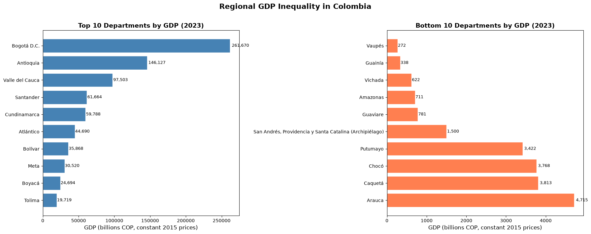
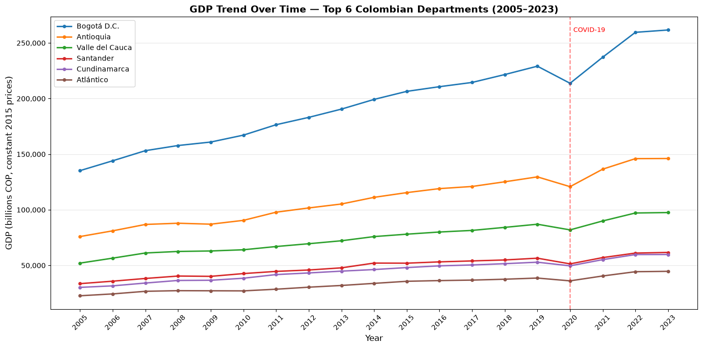
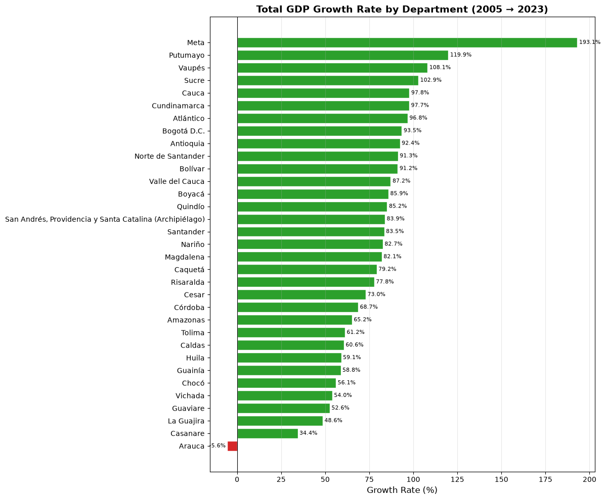
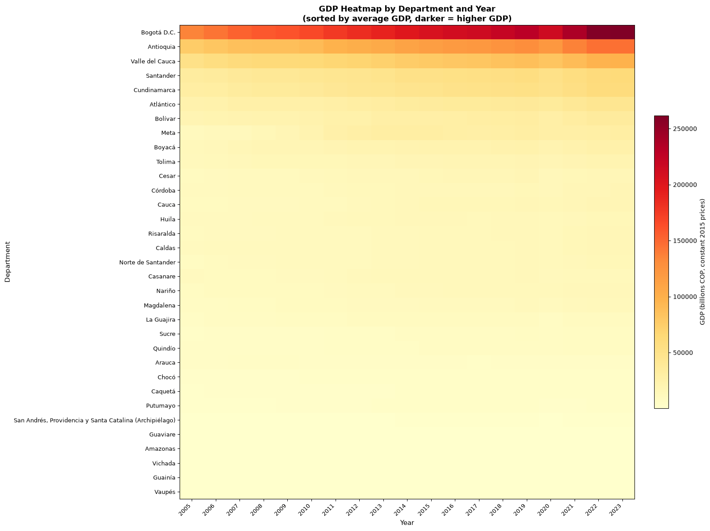
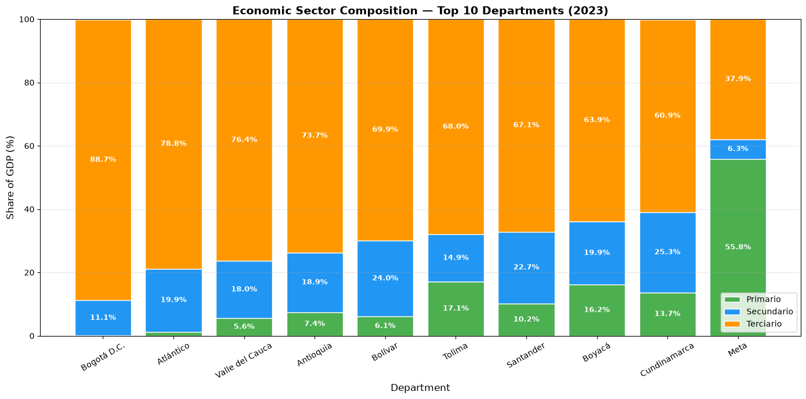

# Colombian Regional GDP Analysis (2005–2023)

How unequal is economic output across Colombia's 33 departments, and who grew fastest? This project cleans and analyzes departmental GDP data from Colombia's open data portal to answer five questions:

1. Which departments have the highest and lowest total GDP?
2. How has each department's GDP evolved from 2005 to 2023?
3. Which departments grew the fastest?
4. What is each department's sector mix (primary, secondary, tertiary)?
5. What does regional inequality look like?

**Tools:** Python · Pandas · NumPy · Matplotlib · Jupyter
**Context:** DAT 301 (Exploring Data in R and Python), Arizona State University, June 2026

## Key findings

- **Output is highly concentrated.** In 2023, Bogotá D.C. and Antioquia together produced about 42% of the GDP summed across all 33 departments; the top three (adding Valle del Cauca) produced about 52%.
- **Growth was broad but uneven.** Almost every department grew between 2005 and 2023 in constant 2015 prices. Meta led with +193%, while Arauca was the only department that shrank (−5.6%).
- **The gap did not close.** The largest departments kept pulling ahead in absolute terms, even where smaller ones grew faster in percentage terms.
- **COVID-19 left a visible dip in 2020** across departments, with most recovering within one to two years.
- **Services dominate the richest economies.** Bogotá's GDP is almost 89% tertiary, while resource-dependent departments such as Casanare (51% primary) are more exposed to commodity prices.







## Data

**PIB Departamental con Proyección**, published by the Gobernación de Caldas on [Datos Abiertos Colombia](https://www.datos.gov.co) (last updated May 18, 2026). 16,302 rows covering year, economic activity, sector, price type, department and value in billions of Colombian pesos.

The raw CSV is not included in this repository. To rerun the notebook, download the dataset from datos.gov.co and save it next to the notebook as `GDP Data.csv`.

## Method

- Cleaned number formats (thousands separators in the year and value columns) and renamed columns to English.
- Kept only **constant 2015 prices** (8,151 rows) so comparisons across years reflect real growth, not inflation.
- Aggregated GDP by department and year, then built rankings, growth rates (2005 → 2023), a department-by-year heatmap and sector shares.

## How to run

```bash
pip install pandas numpy matplotlib jupyter
jupyter notebook colombia_gdp_analysis.ipynb
```

## Author

Santiago Toro · B.S. Business Data Analytics and Data Science, Arizona State University · [LinkedIn](https://www.linkedin.com/in/santiago-toro-bohorquez)
